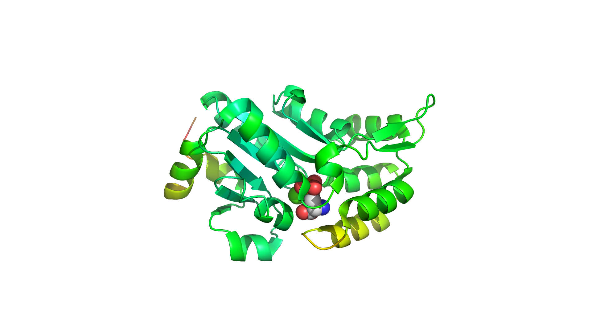
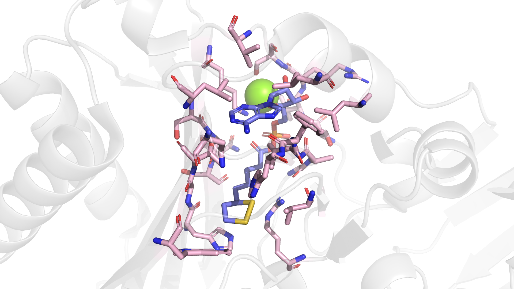
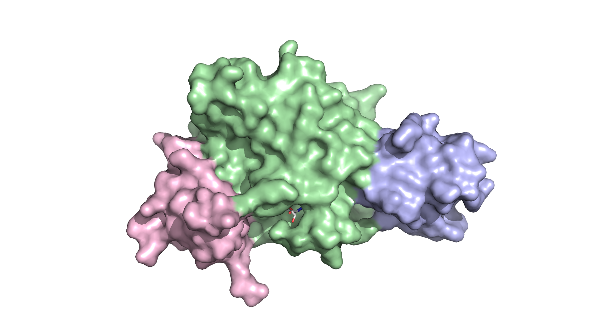
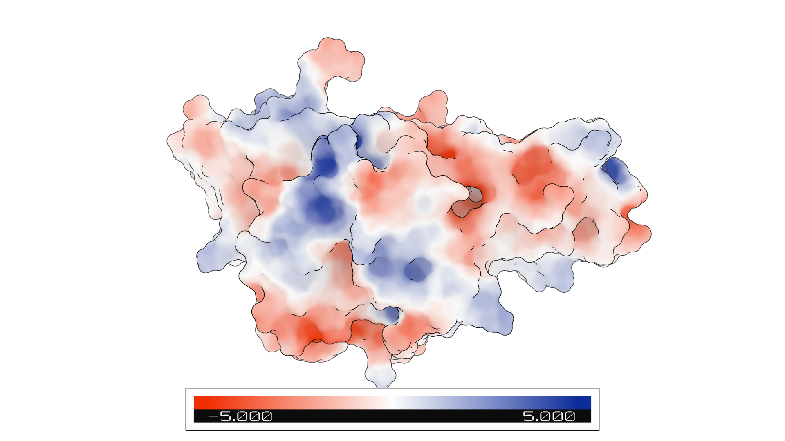
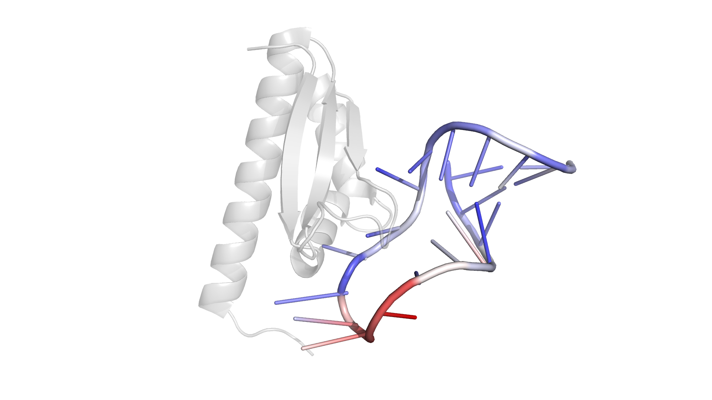

# PyMOLScripts

My PyMOL scripts

## Usage

Install `configs/.pymolrc` and `configs/.pymolrc.py` into your home directory, where PyMOL loads them automatically.

Linux and macOS:

```sh
curl -fsSL https://raw.githubusercontent.com/FridrichMethod/PyMOLScripts/main/install.sh | sh
```

Windows (PowerShell 7):

```powershell
$f = Join-Path ([IO.Path]::GetTempPath()) "PyMOLScripts-install-$PID.ps1"; Invoke-WebRequest -UseBasicParsing -ErrorAction Stop -OutFile $f https://raw.githubusercontent.com/FridrichMethod/PyMOLScripts/main/install.ps1; pwsh -NoProfile -ExecutionPolicy Bypass -File $f; Remove-Item $f
```

The installer writes exactly two files, `~/.pymolrc` and `~/.pymolrc.py` (`%USERPROFILE%\.pymolrc` and `%USERPROFILE%\.pymolrc.py` on Windows), and keeps no other state. Rerun the same command to update: files that are already current are left untouched, changed files are replaced atomically, and a symlink at either path is replaced by a regular file. Nothing is changed unless both files were fetched.

From a clone, `./install.sh` (or `pwsh -File install.ps1`) installs the clone's own copies instead of downloading them. Options: `--prefix DIR` (`-Prefix DIR`) installs into another absolute directory, and `PYMOLSCRIPTS_REF` selects the branch, tag or commit to download (default `main`). Exit status is 0 on success, including when everything is already current, 1 on error and 2 on a usage error.

You may also view and edit these rc files in `PyMOL -> File -> Edit pymolrc`.

## Demos

### Cartoon



### Sticks



### Surface



### APBS (Electrostatic Surface)



### Nucleic Acids


