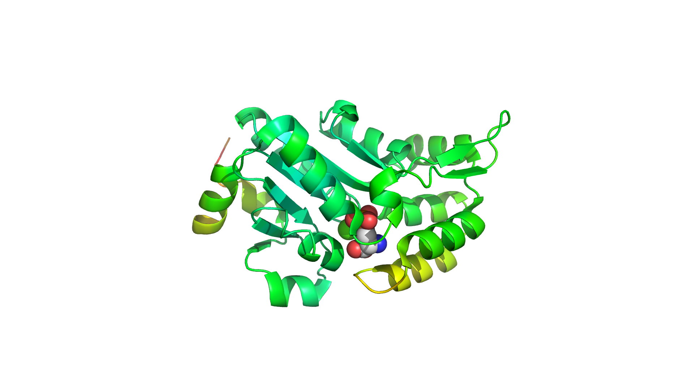
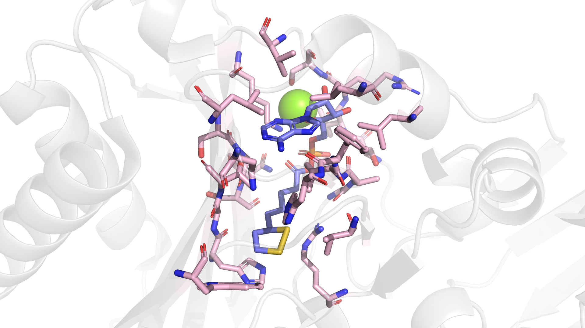
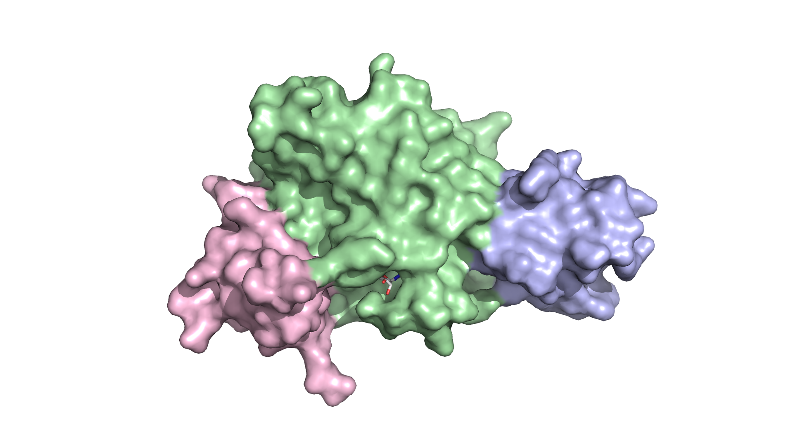
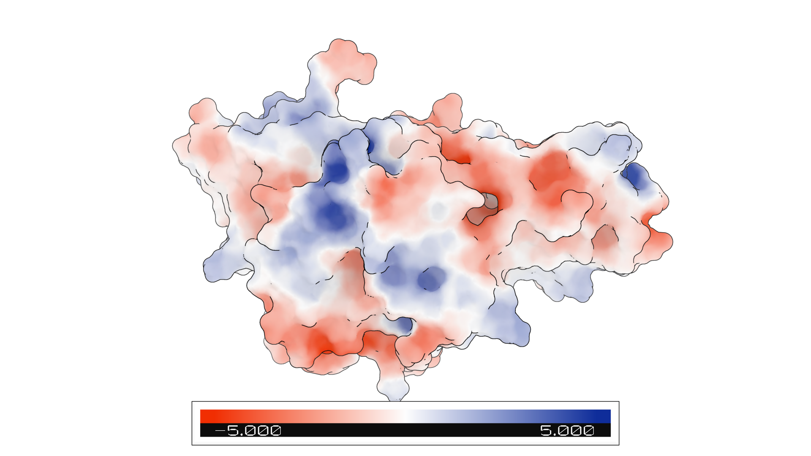
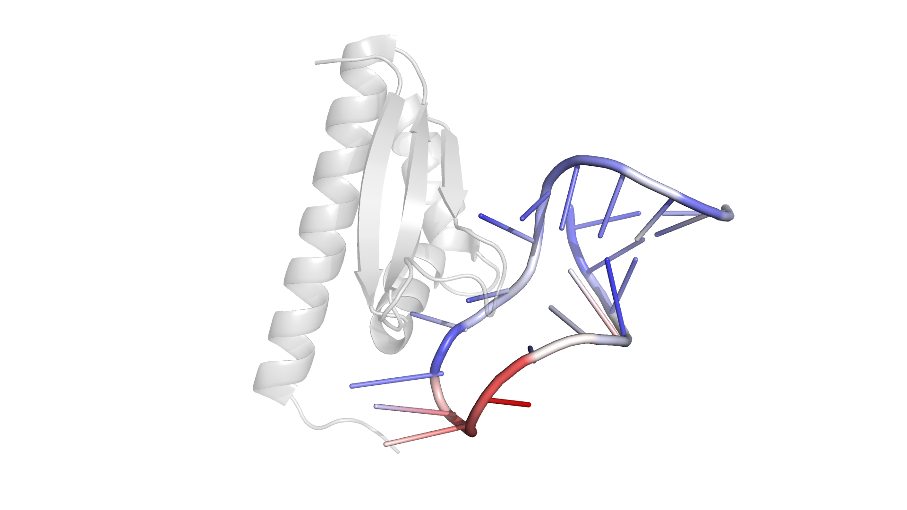

# PyMOLScripts

My PyMOL scripts

## Usage

Install `configs/.pymolrc` and `configs/.pymolrc.py` into your home directory, where PyMOL loads them automatically.

Linux and macOS:

```sh
curl -fsSL https://raw.githubusercontent.com/FridrichMethod/PyMOLScripts/main/install.sh | sh
```

Windows (PowerShell 7):

```powershell
$f = Join-Path ([IO.Path]::GetTempPath()) "PyMOLScripts-install-$PID.ps1"; Invoke-WebRequest -UseBasicParsing -ErrorAction Stop -OutFile $f https://raw.githubusercontent.com/FridrichMethod/PyMOLScripts/main/install.ps1; pwsh -NoProfile -ExecutionPolicy Bypass -File $f; Remove-Item $f
```

The installer writes two files, `~/.pymolrc` and `~/.pymolrc.py` (`%USERPROFILE%\.pymolrc` and `%USERPROFILE%\.pymolrc.py` on Windows), and keeps a copy of what it wrote, the record, under `${XDG_STATE_HOME:-~/.local/state}/pymolscripts/` (`%LOCALAPPDATA%\pymolscripts\` on Windows). Rerun the same command to update: files that are already current are left untouched, changed files are replaced atomically, and a symlink whose content changes is replaced by a regular file instead of being written through. Nothing is changed unless both files were fetched, and a deleted file is simply installed again.

From a clone (a git checkout of your own), `./install.sh` (or `pwsh -File install.ps1`) installs the clone's own copies instead of downloading them. A copy of the installer under another name, or next to a `.git` and `configs/` that are not yours (owned by another user, or symlinks), always downloads, so files someone else placed next to it in a shared directory such as `/tmp` are never installed. Options: `--prefix DIR` (`-Prefix DIR`) installs into another absolute directory, `--force` (`-Force`) overwrites local edits (see below), and `PYMOLSCRIPTS_REF` selects the branch, tag or commit to download (default `main`). Exit status is 0 on success, including when everything is already current, 1 on error, 2 on a usage error and 3 when a local edit stopped the run.

### Local edits

You may view and edit these rc files in `PyMOL -> File -> Edit pymolrc`. Before writing anything, the installer compares each file with its record and with the new upstream copy, ignoring line endings (that editor saves the CRLF files with LF). A file that matches neither was edited locally: the installer then changes nothing at all, prints the file, how to see the edit and the command that overwrites it, and exits with status 3. To keep an edit, either

- commit it to `configs/` here; once an update carries it, the next run finds the file current, or
- move host-only settings to `~/.pymolrc.local.pml`, which PyMOL runs after `.pymolrc.py` and `.pymolrc` and the installer never touches.

To overwrite the edit instead, rerun with `--force`, for example

```sh
curl -fsSL https://raw.githubusercontent.com/FridrichMethod/PyMOLScripts/main/install.sh | sh -s -- --force
```

or, on Windows, the PowerShell line above with `-File $f -Force`. Each edited file is first copied to `~/.pymolrc.local-YYYYmmddHHMMSS` (or `~/.pymolrc.py.local-...`, with `-N` added when the name is taken), a name PyMOL never runs. An edited symlink is replaced without a copy, and its target is left untouched.

Files installed before the record existed have none. The first run records them without stopping when they match the new upstream copy, or update them when they match the configs at commit `41785ca`, which is all that earlier installs wrote; any other unrecorded file counts as a local edit.

## Demos

### Cartoon



### Sticks



### Surface



### APBS (Electrostatic Surface)



### Nucleic Acids


